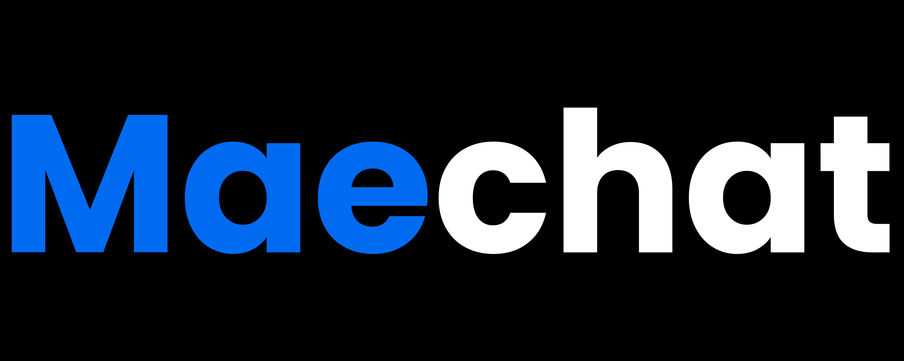
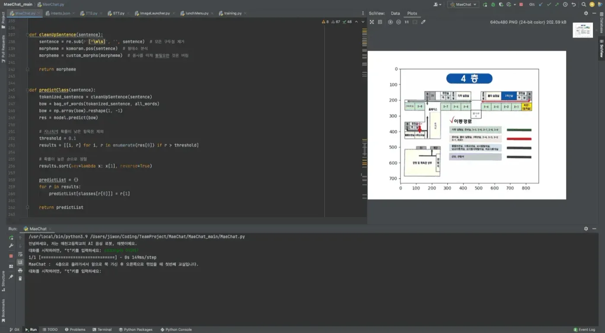

# 🤖 MaeChat

**매천고등학교 안내 AI 챗봇 — 상용 LLM 이전, 텍스트 분류 모델을 직접 학습시켜 만든 챗봇**

## 소개

2022년, 매천고등학교 재학 중 팀원 4명과 함께 만든 학교 생활 안내 챗봇입니다. ChatGPT 이전이라 LLM API를 쓸 수 없었기 때문에, **사용자 발화의 의도(intent)를 분류하는 신경망을 직접 설계하고 학습**시키는 방식을 택했습니다.

**Team MaeChat** — 김민주 · 백연경 · 송도훈 · 정지원 (팀 리더)

## 동작 방식

1. **전처리** — Komoran 형태소 분석기로 조사 등을 걸러 의미 있는 어휘만 추출
2. **벡터화** — 어휘 사전을 만들고 문장을 Bag-of-Words 벡터로 변환
3. **분류 모델** — `Dense(128) → Dropout → Dense(64) → Dropout → Softmax`, SGD로 200 epoch 학습 후 `chatbot_model.h5`로 저장
4. **응답** — 분류된 의도에 맞는 답변을 `intents.json`에서 골라 출력

## 기능

- 💬 학교 생활 안내 (교실 위치는 층별 지도 이미지로 안내)
- 🍱 급식 메뉴 조회
- 🌤️ 날씨 정보 (실시간 크롤링)
- 🎙️ 음성 대화 (STT · gTTS)

## 구조

| 파일 | 역할 |
|---|---|
| `training.py` | 데이터 전처리 · 모델 학습 |
| `MaeChat.py` | 챗봇 실행 |
| `STT.py` · `TTS.py` | 음성 입출력 |
| `lunchMenu.py` | 급식 메뉴 |
| `weatherCrawling.py` · `weatherForecast.py` | 날씨 |
| `ImageLauncher.py` · `assets/Maps/` | 교실 위치 지도 |

## 한계와 배운 점

- Bag-of-Words는 어순과 문맥을 반영하지 못해, 부정 표현이 들어간 문장의 의도가 뒤바뀌어 분류되기도 했습니다.
- `intents.json`에 정의된 범위 안에서만 답할 수 있는 폐쇄형 구조라, 학습하지 않은 질문은 가장 비슷한 태그로 잘못 분류됐습니다.

참고: [(자연어처리/챗봇) 텐서플로로 챗봇 만들기](https://madrabbit7.tistory.com/77)
